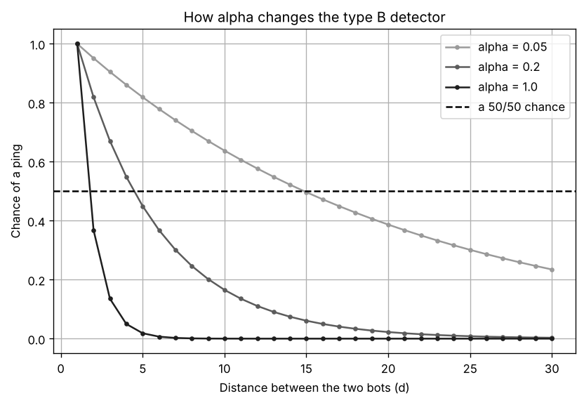
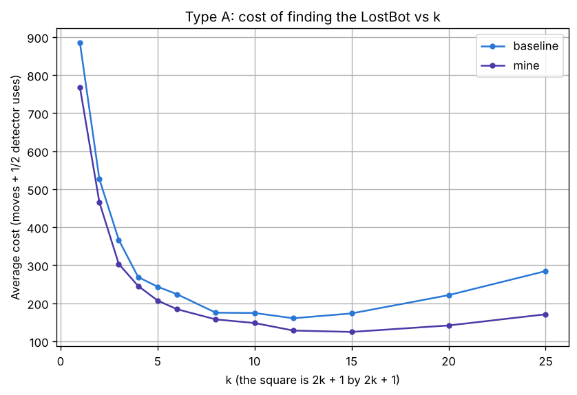
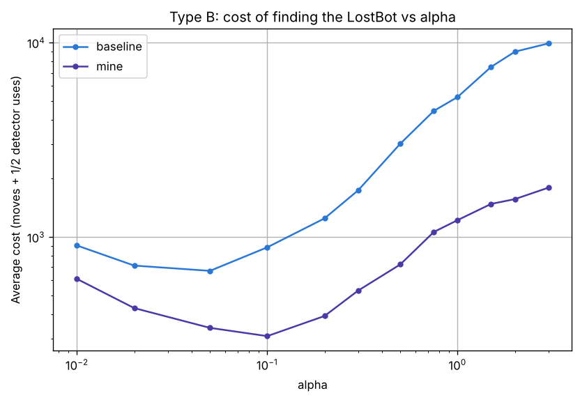
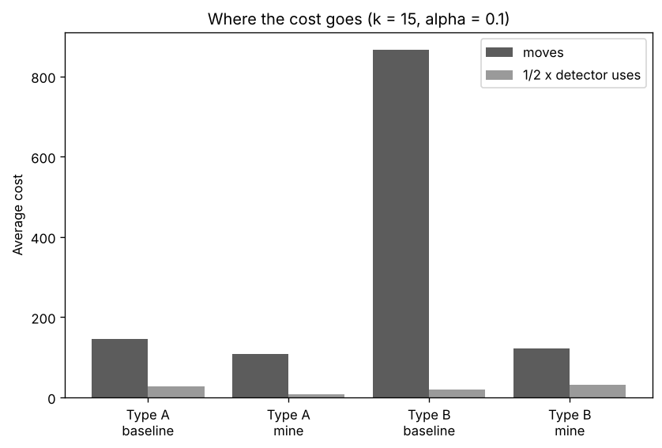
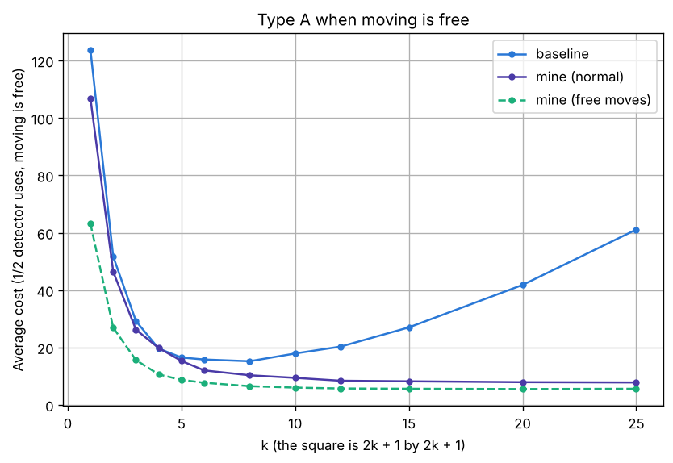
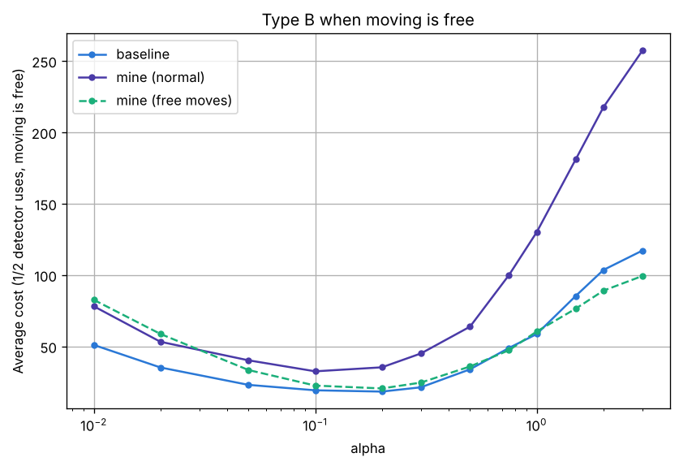

# Project 2: Where is it?

Rahul Rajkumar (NetID: rr1437)

## 1. The setup, and the range of k and alpha

Project 2 is built on top of my Project 1 code. The ship is generated the same
way, with the same `ship.py`, so trial i gives the same ship as in Project 1.
The LocatorBot moves with the same BFS, and the BFS distance map gives the
number of moves it takes to reach every cell. In each trial, the LocatorBot and
the LostBot start in two random open cells, and the LostBot never moves. The
LocatorBot only finds the LostBot by running the detector in the LostBot's
cell. The cost of a search is the number of moves plus half the number of
detector uses.

**The range of k and alpha (the question for analysis on page 1).**

For type A, k is the size of the square. With k = 0, the square is only the
LocatorBot's own cell, so the detector gives no new information. With k
of D - 1 or more, the square covers the whole ship from anywhere, so it always
pings and also gives no information. On a 50 by 50 ship, k = 25 already
covers almost the whole ship from the middle, so I tested k from 1 to 25. A
small square only pings when the LostBot is close, but then the LostBot must be
in one of a few cells. A big square pings from far away, but then the LostBot
is only known to be somewhere in a big area. This is how k sets the
sensitivity of the detector.

For type B, the chance of a ping depends on the distance d to the LostBot, and
it drops to 0.5 at this distance:

$$P(\text{ping}) = e^{-\alpha(d-1)} = 0.5 \quad \text{when} \quad d = 1 + \frac{\ln 2}{\alpha}$$

The distances on a 50 by 50 ship go up to about 69. At alpha = 0.01, the chance only drops to 0.5 at a
distance of 70, so the detector pings almost everywhere and a ping gives very
little information. At alpha = 3, it drops to 0.5 at a distance of 1.23, so
the detector only pings right next to the LostBot and a no ping gives very
little information. So I tested 12 values of alpha between 0.01 and 3,
spread out on a log scale. Alpha sets how fast the detector goes cold as the
LostBot gets further away (Figure 1). A small alpha reaches far but is
fuzzy, and a big alpha is sharp but only works up close.

*Figure 1: The chance of a type B ping based on how far away the LostBot is, for a small, a medium and a big alpha.*

## 2. Updating the knowledge base (Question 1)

**Type A.** The knowledge base is S, the set of cells the LostBot could still
be in. At the start, S is every open cell. Let the LocatorBot be in cell a.
The square around a is every cell whose row and column are both at most k
away from those of a. When the LocatorBot runs the detector and does not find
the LostBot:

- **ping:** new S = the cells in S, without a, that are **inside** the square around a
- **no ping:** new S = the cells in S, without a, that are **outside** the square around a

This is correct because the type A detector is never wrong. It pings exactly
when the LostBot is inside the square, and it would have said "found" if the
LostBot were in a. So a cell is only removed when the LostBot being there
would contradict a reading, which is a proof by contradiction from class. The
real cell is never removed, since it always agrees with every reading. This is
also a CSP from class with one variable, the location of the LostBot. Every
open cell starts in its domain, every reading is a constraint, and the update
removes the cells that break it. The code does exactly this. It goes through
every cell and checks whether the detector would have given the same reading if
the LostBot were in that cell. If not, that cell is removed.

**Type B.** The knowledge base is P(b), the chance that the LostBot is in
cell b. At the start, every open cell has the same chance, 1/N for N
open cells. When the LocatorBot in cell a runs the detector and does not
find the LostBot, it first sets P(a) = 0, since the detector would have said
"found". Then, for the reading r (ping or no ping), it updates every cell
with Bayes' rule:

$$P(b \mid r) = \frac{P(b) \, P(r \mid b)}{\sum_{b'} P(b') \, P(r \mid b')}$$

where the chance of each reading depends on the euclidean distance d(a, b)
between a and b:

$$P(\text{ping} \mid b) = e^{-\alpha (d(a, b) - 1)}, \qquad P(\text{no ping} \mid b) = 1 - e^{-\alpha (d(a, b) - 1)}$$

In words:

**new chance of b** = (old chance of b × chance of this reading if the LostBot is in b) ÷ (that same product added up over every cell)

Dividing by the total on the bottom makes all the chances add up to 1 again.
The b' on the bottom means every cell, one at a time.

This is correct because it is Bayes' theorem, the same as the two coins
example from class. The old knowledge base is the prior, the reading is the
data, and the bottom is the total chance of getting that reading, found by
marginalization. It is also a small Bayesian network with the same shape as
Coin → Flip 1, Flip 2 from class. The location of the LostBot is the hidden
parent, and every reading is a child. The readings do not affect each other
once the location is known, since the detector flips a new coin every time. So
the knowledge base can be updated one reading at a time, and the order does
not matter. I checked this in code, and updating one reading at a time, all at
once, and in reverse order all gave the same knowledge base. Right next to the
LocatorBot (d = 1), the chance of a ping is 1, so a no ping rules out those 4
cells completely.

## 3. My strategies (Question 2)

Each of my strategies is built on one idea from the course and uses one
scoring rule. I also tested other ideas from the course on a small number of
ships: hill climbing over detector spots for type A, and for type B, choosing
a random target cell using the probabilities (sampling) and a "treasure map"
built with the utility recursion from the MDP lecture. They also beat the
baselines, but I chose the two strategies below because they are the simplest
and differ the most from the baselines.

**Type A: minimax.** In the game trees from class, the max player picks the
move whose worst case is the best, because it assumes the min player will
always answer in the worst way for it. My type A strategy treats the search the
same way. The LocatorBot is the max player, since it picks where to run the
detector, and the detector is the min player, since it decides the answer.

For any spot x, a ping removes every possible cell outside its square, and a
no ping removes every possible cell inside it. So whatever the answer is, a
reading at x is sure to remove at least the smaller of those two groups:

$$\text{sure}(x) = \text{here} + \min(\text{inside}, \text{outside})$$

In this formula, inside is the number of possible cells inside the square, not
counting x, and outside is the number of possible cells outside it. The value
of here is 1 if the LostBot could be in x itself, since then x is removed either
way, and 0 if not. The LocatorBot goes to the spot with the best score

$$\text{score}(x) = \frac{\text{sure}(x)}{\text{moves}(x) + \frac{1}{2}}$$

where moves(x) is the number of moves to get there (from BFS) and the 1/2 is
the detector use. Ties go to the closest spot.

This one rule acts differently before and after the first ping. Before a ping,
the inside of a fresh square is small compared to the rest of the ship, so the
score depends on how many unsearched cells the square holds. The best spot is
usually just past the edge of what has already been searched. The baseline
reads right on that edge, so about half of its square was already searched.
After a ping, every possible cell is inside one square, so the best spot is one
whose square cuts them in half, since then neither answer is bad. This is
binary search, while the baseline goes back to checking the nearest cell one at
a time. The best spot is often a cell where the LostBot cannot be, which the
baseline never considers. I used the worst case instead of the average because
an even split is good whatever the answer is, while an uneven split is only
good with luck.

**Example (type A).** Take a 5 by 5 ship with every cell open and k = 1, so
every square is 3 by 3.

1. The LocatorBot starts in the corner (0, 0) and gets no ping. Its square there
   is only the 4 cells (0, 0), (0, 1), (1, 0) and (1, 1), so those 4 are
   removed and 21 cells are still possible.
2. Wherever it runs the detector next, a ping removes every possible cell
   outside the square, and a no ping removes every possible cell inside it. So
   the number of cells it is sure to remove is the smaller of those two groups,
   and the score is that number divided by the cost (the moves plus 1/2).
3. The baseline walks 2 moves to the nearest possible cell, (0, 2) or (2, 0).
   Its square there only has 4 possible cells, since the rest was already
   searched, so it is sure to remove 4 cells. Its score is 4 / 2.5 = 1.6.
4. My strategy also walks 2 moves, but to (1, 1). This may seem
   counterintuitive, since the LostBot cannot be there, but its square has 5
   possible cells, (0, 2), (1, 2), (2, 0), (2, 1) and (2, 2), and 16 outside.
   So whatever the answer is, it is sure to remove at least 5 cells. Its score
   is 5 / 2.5 = 2.0, the best on the ship. A few cells further away also get
   2.0, but ties go to the closest.

So for the same 2 moves, my strategy learns more, because its square is not
spent on cells that were already searched.

**Type B: warmer or colder (hill climbing).** My type B strategy uses hill
climbing from the local search notes, like the game warmer or colder. In hill
climbing, you look at the states next to you and move to the best one if it is
better than where you are. Here, the state is the cell of the LocatorBot, the
states next to it are the open cells next to it, and better means warmer.

The warmth of a cell x is the chance that running the detector there pings,
or finds the LostBot. It comes from marginalization, like P(H) in the two
coins example:

$$\text{warmth}(x) = \sum_{b} P(b) \, P(\text{ping} \mid \text{LocatorBot in } x, \text{LostBot in } b)$$

The cell of the LostBot itself counts as 1, since there the detector says
found, which is even better than a ping. Each step works like this:

1. Run the detector in the current cell and update the knowledge base.
2. Find the warmth of the current cell and of the open cells next to it.
3. If a cell next to it is warmer, step to the warmest one.
4. If none are warmer, the LocatorBot is at the top of a hill. Then it walks to
   the most likely cell, like the baseline. This is a kind of restart, but not
   a random one like in class, since it restarts where the LostBot most likely
   is.

Unlike hill climbing in class, the hill here changes after every reading. A
ping makes the cells around the LocatorBot warmer, so it keeps climbing towards
them. A no ping makes them colder and pushes it away.

This should beat the baseline because the baseline makes one decision and then
walks the whole way without running the detector. After a no ping, the most
likely cell is the one furthest away, so the baseline walks across the ship and
learns nothing on the way. My strategy runs the detector in every cell it steps
on, which costs half a move each, and lets every reading change where it goes
next. Warmth is also smoother than the probabilities. A cell is warm if a lot
of probability is near it, not just in it, so the LocatorBot heads for the area
where the LostBot probably is, instead of one cell that is only slightly more
likely than the cells around it.

**Example (type B).** Take a small ship that is just 4 cells in a row, cells 1
to 4, with alpha = 1.

1. Each cell starts with a chance of 1/4. The LocatorBot starts in cell 1 and
   gets no ping. With the update rule from question 1, cell 1 goes to 0, and
   cell 2 also goes to 0, since it is right next to cell 1 and would have pinged
   for sure. Cells 3 and 4 become 0.422 and 0.578.
2. The baseline walks straight to cell 4, the most likely cell. That is 3 moves
   without running the detector on the way.
3. My strategy only compares where it is with the cell next to it. The warmth
   of a cell is the chance the detector pings there. For cell 1 it is
   0.422 × e^(-1) + 0.578 × e^(-2) = 0.234, and for cell 2 it is
   0.422 × 1 + 0.578 × e^(-1) = 0.635.
4. Cell 2 is warmer, so it steps there and runs the detector again. If the
   LostBot is in cell 3, the detector pings for sure, since it is right next to
   it, so this one reading gives a lot of information.

Averaged over 4,000 searches for each cell the LostBot could be in, a whole
search costs 3.5 with my strategy and 3.61 with the baseline. The baseline does
better when the LostBot is in cell 4, since walking straight there is correct,
but on a real ship the walks are much longer, so checking along the way saves
much more (Section 5).

**Scoring rules, and my TA's advice.** My TA advised that, when choosing where
to run the detector, I should consider the cost of the rest of the search and
not only how much the knowledge base shrinks, and that I should state the
scoring rule clearly and compare it with the baselines. The table below gives
the score of every strategy, including the baselines:

| strategy | where it can run the detector next | the score it picks the best of |
|---|---|---|
| baseline type A | the nearest possible cell | fewest moves |
| my type A | any open cell | sure(x) / (moves(x) + 1/2) |
| baseline type B | the most likely cell, ties by distance | P(b) |
| my type B | a cell next to it, or the most likely cell at the top of a hill | warmth |
| my type A, free moves | any open cell | sure(x) |
| my type B, free moves | any open cell | warmth closest to 0.5, every other reading P(b) |

Each baseline only considers one side of this. Baseline A only considers cost.
It goes to the closest possible cell and never checks how much a reading there
would remove, which is why about half of its square is usually already
searched. Baseline B only considers the knowledge base. It goes to the most
likely cell and never checks how far away it is, which is why it walks across
the ship after every no ping.

My type A score puts both sides in one number. The top is how much the
knowledge base is sure to shrink, and the bottom is the cost of getting there,
so a spot that removes many cells is not picked if it is too far away. I used
the worst case instead of the average, since it is simpler and does not rely on
luck. For type B, I kept the cost side simple instead of computing it. Every
step has the same cost, one move and one reading, so the score only has to
compare warmth, and the LocatorBot never pays for a long walk without learning
anything. When moving is free, the cost side is 0, so both scores only measure
how much a reading tells us. Sections 4 to 7 compare every strategy with its
baseline.

## 4. Type A: baseline vs my strategy (Question 3)

All experiments use 50 by 50 ships, the same size as Project 1. Larger ships
were not used because both the number of cells to check after each reading and
the length of each search grow with the size of the ship, which would make the
full set of experiments take several hours. I ran 200 searches for each
strategy at each k. Both strategies search the same 200 ships from the same
starting cells, so any difference comes from their decisions and not from
easier ships.

*Figure 2: The average cost of finding the LostBot with the type A detector, for every k, with 200 searches at each k (from results/type_a_cost.csv).*

*Table 1: The average cost of each type A strategy, and how much cheaper mine is.*

| k | baseline | mine | % cheaper |
|---|---|---|---|
| 1 | 884.7 | 767.6 | 13.2 |
| 2 | 526.6 | 465.7 | 11.6 |
| 3 | 366.7 | 303.2 | 17.3 |
| 4 | 268.8 | 245.5 | 8.7 |
| 5 | 243.6 | 207.2 | 14.9 |
| 6 | 223.8 | 184.3 | 17.6 |
| 8 | 175.2 | 157.5 | 10.1 |
| 10 | 174.4 | 148.0 | 15.1 |
| 12 | 160.5 | 128.2 | 20.1 |
| 15 | 173.3 | 124.6 | 28.1 |
| 20 | 221.3 | 141.7 | 36.0 |
| 25 | 284.6 | 171.0 | 39.9 |

My strategy is cheaper at every k, from 9% cheaper at k = 4 to 40% cheaper
at k = 25. It is not cheaper on every single search, only on 56% to 64% of
them depending on k, but it is always cheaper on average.

For small k, both strategies are expensive. A small square means sweeping
most of the ship, so almost all of the cost is walking. At k = 1, the
baseline makes 761 moves and my strategy makes 676. My strategy still saves 9%
to 18% there, because it reads past the edge of what has been searched instead
of right on it.

For big k, the baseline becomes expensive again (285 at k = 25). The first
reading usually pings, and then it checks cells one at a time, so it runs the
detector 122 times. My strategy only needs about 13 readings, since after the
ping every reading cuts the possible cells in half.

The most interesting k regime is about k = 8 to k = 15, which is about
D/6 to D/3. This is where both strategies are cheapest. Mine is lowest at
k = 15 (124.6) and the baseline is lowest at k = 12 (160.5). It is also
where cutting the possible cells in half starts to pay off, so the gap between
the strategies grows, from 20% at k = 12 to 28% at k = 15.

**Why these results may have occurred.** The gain from my strategy likely grows
with k because the first ping comes earlier when the square is bigger. With a
small square, most of the search happens before any ping, and there both
strategies have to sweep the ship, so my strategy can only save the overlap
between squares. With a big square, the first reading usually pings, so most of
the search happens after a ping, which is where binary search is much better
than checking one cell at a time. The gain is not perfectly smooth (8.7% at
k = 4 and 10.1% at k = 8), which may come from the walls and dead ends of the
ship, since they decide whether a fresh square can be placed just past the
searched edge, and from the variation between only 200 searches. My strategy is
not cheaper on every search because, when the LostBot starts close to the
LocatorBot, the nearest first order of the baseline finds it right away, while
my strategy may first read a spot further out. Finally, both strategies cost
more again for very big k, likely because a ping from a big square leaves a big
area, and the spots that cut that area in half are about k moves apart, so
every reading needs a longer walk.

## 5. Type B: baseline vs my strategy (Question 4)

I picked the values of alpha where the detector stops being useful on both
ends (Section 1). At alpha = 0.01 it pings almost everywhere, and at
alpha = 3 it only pings right next to the LostBot. The ping chance changes
the most for small alpha, so I spread the values out on a log scale instead
of evenly. I also checked that the cost goes back up at both ends, so the best
alpha is inside the range.

*Figure 3: The average cost of finding the LostBot with the type B detector, for every alpha, with 200 searches at each alpha (from results/type_b_cost.csv). Both axes are on a log scale since the baseline costs are so much bigger.*

*Table 2: The average cost of each type B strategy, and how much cheaper mine is.*

| alpha | baseline | mine | % cheaper |
|---|---|---|---|
| 0.01 | 905.3 | 609.4 | 32.7 |
| 0.02 | 713.4 | 431.2 | 39.6 |
| 0.05 | 670.3 | 341.1 | 49.1 |
| 0.1 | 885.7 | 309.3 | 65.1 |
| 0.2 | 1248.1 | 392.6 | 68.5 |
| 0.3 | 1738.4 | 530.1 | 69.5 |
| 0.5 | 3023.0 | 723.3 | 76.1 |
| 0.75 | 4459.1 | 1062.4 | 76.2 |
| 1 | 5257.0 | 1222.6 | 76.7 |
| 1.5 | 7513.2 | 1481.3 | 80.3 |
| 2 | 8992.2 | 1567.8 | 82.6 |
| 3 | 9917.3 | 1795.8 | 81.9 |

My strategy is 33% to 83% cheaper at every alpha, and cheaper on 70% to 90%
of the searches. Almost all of the cost of the baseline is walking. After a no
ping, the most likely cell is the furthest one, so it walks across the ship
without running the detector once. The bigger alpha is, the more often it
does not ping, so the more it walks. At alpha = 0.1, the baseline makes 867
moves and my strategy makes 277. My strategy runs the detector more, 65 times
against 38, but a reading only costs half a move, and every reading shows it
which way is warmer.

My strategy is cheapest at alpha = 0.1 (309.3), and the baseline at
alpha = 0.05 (670.3). At alpha = 0.1, the ping chance drops to 0.5 at
about 8 cells away, so moving one cell changes the warmth enough to show which
way to go.

My strategy helps the least at small alpha, only 33% cheaper at
alpha = 0.01. There, the detector pings from almost anywhere, so every cell
is about as warm as the next and the hill is very flat. The LocatorBot keeps
reaching a top and walking to the most likely cell, the same as the baseline.
Over 15 searches, 23% of its decisions at alpha = 0.01 were a top, compared
to 7% at alpha = 1. For big alpha, the detector only pings right next to
the LostBot, so the search turns into checking cells almost one at a time, and
the cost goes up to 1795.8 at alpha = 3. My strategy still avoids the long
walks of the baseline.

**Why these results may have occurred.** The cost of the baseline likely grows
so fast with alpha because, for a big alpha, almost every reading away from the
LostBot is a no ping. Each no ping pushes the probability to the far side of
the ship, so the baseline keeps walking back and forth across the ship. At
alpha = 3 it walks about 9,800 moves but only runs the detector 234 times. My
strategy never walks that far without reading, so its cost only grows because
the detector becomes local, which is why the gain grows from 33% to 83% as
alpha grows. The two strategies may also prefer different values of alpha for
different reasons. The baseline is cheapest at the smaller alpha = 0.05, since
a detector that pings more often gives fewer no pings and so fewer long walks.
My strategy is cheapest at alpha = 0.1, since it needs the warmth to change
clearly from one cell to the next. My strategy is not cheaper on every search
because, when the LostBot is in the area the baseline walks to first, its long
walk happens to be correct, as in the type B example in Section 3.

## 6. Which detector is more efficient? (Question 5)

At their best settings, type A is cheaper. With my strategies, type A costs
124.6 at k = 15 and type B costs 309.3 at alpha = 0.1, so type A is about
60% cheaper, or 2.5 times. With the baselines the gap is even bigger, 160.5 at
k = 12 against 670.3 at alpha = 0.05.

*Figure 4: Where the cost goes for each strategy at k = 15 and alpha = 0.1: the average number of moves, and half the average number of detector uses.*

The reason is that a type A reading is certain. A ping or a no ping removes
cells for good and is never wrong, so after the first ping every reading cuts
the possible cells in half, and my strategy only needs about 13 readings in a
whole search. A type B reading is a coin flip. One ping does not prove the
LostBot is close, and one no ping does not prove it is far. So the LocatorBot
has to keep reading as it walks (65 readings at alpha = 0.1), and it walks
more too (277 moves against 118), since it decides which way to go one step at
a time. Figure 4 shows that most of the difference is the extra walking.

## 7. When moving is free (Question 6)

If only the detector has a cost, both of my strategies change, because walking
no longer matters.

For type A, my minimax strategy drops the cost. It picks the spot anywhere on
the ship that is sure to remove the most cells, without dividing by the walk.
This works like the game 20 questions, where every reading splits the possible
cells as close to half as it can.

For type B, warmer or colder no longer makes sense, since its purpose is to
take small steps instead of long walks. So I changed it to a fairest coin rule.
A reading whose answer can already be guessed gives no information, like
flipping a coin that is known to be double headed. So the LocatorBot runs the
detector where the chance of a ping (the warmth) is closest to 0.5. However, a
fair coin far away cannot tell apart cells that are right next to each other,
and the only way to find the LostBot is to read in its cell. So every other
reading, it checks the most likely cell instead, like the baseline. Since
moving is free, it can also read in the same cell twice in a row if that is
still the best spot.

*Figure 5: Type A when moving is free: the cost (half the detector uses) of the baseline, of my normal strategy, and of my strategy changed for free moves (from results/type_a_free_moves.csv).*

*Figure 6: The same for type B (from results/type_b_free_moves.csv).*

*Table 3: The cost when moving is free (half the detector uses) at a few values of k and alpha.*

| | baseline | mine (normal) | mine (free moves) |
|---|---|---|---|
| type A, k = 8 | 15.2 | 8.8 | 6.8 |
| type A, k = 20 | 41.8 | 6.5 | 5.9 |
| type B, alpha = 0.02 | 35.2 | 53.2 | 58.7 |
| type B, alpha = 0.2 | 18.3 | 35.3 | 20.5 |
| type B, alpha = 2 | 103.5 | 217.5 | 89.0 |

For type A, the change makes a big difference. My free moves strategy is 45% to
90% cheaper than the baseline. From k = 15 up, it needs about 11.7 readings,
a cost of 5.9. This is close to perfect binary search, which would need
log base 2 of the roughly 1,600 open cells, about 10.7 readings. The best k
also goes up. When walking is free, a bigger square is better since it can
split the ship anywhere, so the cost keeps dropping until k = 15 and then
stays flat. The baseline is best at k = 8 (15.2) and gets worse after that,
since it still checks cells one at a time after the first ping. My normal
strategy is already close (6.5 at k = 20), since it already does binary
search after the first ping.

For type B, the fairest coin was only partly successful:

- for alpha up to 0.05, it costs 45% to 67% more than the baseline
- for alpha from 0.1 to 0.3, it costs 12% to 17% more
- for alpha from 0.5 to 1, it costs about the same
- for alpha of 1.5 and up, it is 10% to 15% cheaper

The reason is where the fair coin is. The spot where the ping chance is 0.5 is
about 1 + ln(2) / alpha cells away from where the LostBot probably is. At
alpha = 0.01 that is 70 cells, so the LocatorBot reads from the far side of
the ship. From that far away, all the likely cells are about the same distance,
so the reading cannot tell them apart and gives little information. For big
alpha, the fair coin is only 1 or 2 cells from the likely area, so one
reading tests a small group of cells at once, which is better than checking one
cell at a time like the baseline. My normal warmer or colder strategy costs 1.5
to 2.2 times as much as the baseline here, because it reads on every step to
save walking, and walking is now free.

Type A is still the more efficient detector, by even more than before. It costs
5.9 at k = 15 and up, against 18.3 for the best type B result, which is the
baseline at alpha = 0.2 (my fairest coin gets 20.5 there). That is about 3
times cheaper. With free moves, the only thing that matters is how much each
reading tells us, and a certain reading that can split the ship in half is worth
much more than a coin flip.

## 8. Conclusion

My type A strategy assumes the detector always gives the worst answer, and that
one rule makes it read past the edge of what it has searched before a ping and
do binary search after one. It is 9% to 40% cheaper than the baseline at every
k. My type B strategy decides again after every step instead of walking
blindly to the most likely cell, which makes it 33% to 83% cheaper at every
alpha. At their best settings, the type A detector is about 2.5 times
cheaper than type B, because a certain reading gives much more information than
a coin flip. When moving is free, type A becomes close to perfect binary
search, while the fairest coin for type B only beats the baseline for big
alpha, since a reading also has to be able to tell apart the cells that
matter.
